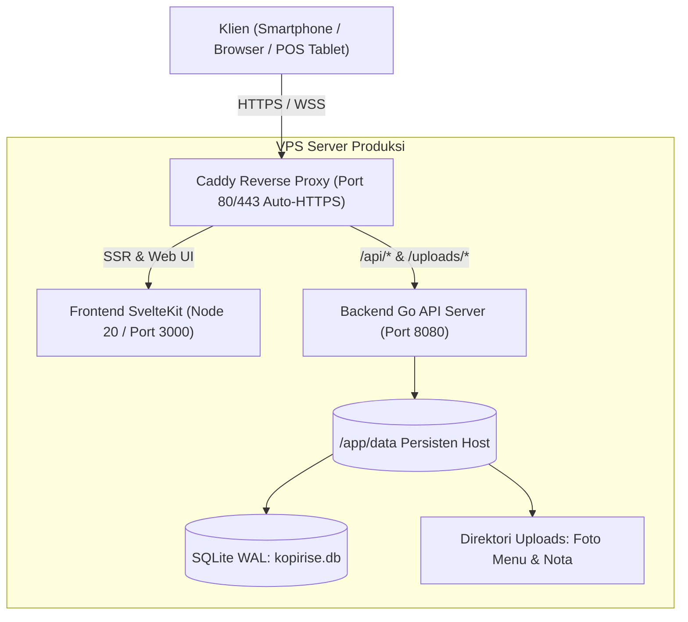

# PANDUAN DEPLOYMENT & ARSITEKTUR PRODUKSI KOPIRISE

Dokumen ini menjelaskan prosedur instalasi, konfigurasi keamanan, pencadangan basis data, dan pemulihan bencana (*Disaster Recovery*) untuk sistem **KopiRise Cafe Management System**.

---

## 1. Kebutuhan Server Minimum (Hardware & OS)

| Komponen | Spesifikasi Minimum | Spesifikasi Rekomendasi |
| :--- | :--- | :--- |
| **CPU** | 1 vCPU (x86_64 atau ARM64) | 2 vCPU |
| **RAM** | 1 GB | 2 GB - 4 GB |
| **Penyimpanan** | 20 GB SSD / NVMe | 40 GB NVMe |
| **Sistem Operasi** | Ubuntu 22.04 LTS / Debian 12 / Alpine Linux | Ubuntu 24.04 LTS |
| **Software** | Docker Engine 24+, Docker Compose 2.20+ | Docker Compose Plugin |

---

## 2. Arsitektur Deployment Docker

Sistem KopiRise di-deploy menggunakan container Docker terisolasi yang diorkestrasi oleh `docker-compose.yml`:



---

## 3. Langkah-Langkah Deployment

### Langkah 3.1: Kloning Repositori & Persiapan Direktori
```bash
git clone https://github.com/your-org/kopirise.git /opt/kopirise
cd /opt/kopirise
mkdir -p data/uploads/receipts data/uploads/menu data/backups
chmod -R 755 data
```

### Langkah 3.2: Konfigurasi Environment File
Salin template konfigurasi:
```bash
cp .env.example .env
nano .env
```
Isi konfigurasi produksi:
```env
KOPIRISE_DOMAIN=kopirise.id
KOPIRISE_ENV=production
KOPIRISE_SESSION_SECRET=64_karakter_acak_kriptografis_disini
```

### Langkah 3.3: Menjalankan Container Produksi
```bash
docker compose up -d --build
```

Periksa status container:
```bash
docker compose ps
docker compose logs -f backend
```

---

## 4. Strategi Backup & Disaster Recovery SQLite

KopiRise menggunakan mode **Write-Ahead Logging (WAL)** pada SQLite, yang memungkinkan pembacaan berkecepatan tinggi tanpa memblokir penulisan.

### 4.1 Prosedur Backup Otomatis (`VACUUM INTO`)
Perintah `VACUUM INTO` membuat salinan point-in-time yang 100% konsisten bahkan saat sistem sedang melayani transaksi POS secara intensif.

Buat skrip backup harian di `/opt/kopirise/scripts/backup.sh`:
```bash
#!/bin/bash
set -euo pipefail

BACKUP_DIR="/opt/kopirise/data/backups"
TIMESTAMP=$(date +"%Y%m%d_%H%M%S")
BACKUP_FILE="${BACKUP_DIR}/kopirise_backup_${TIMESTAMP}.db"

mkdir -p "$BACKUP_DIR"

# Eksekusi VACUUM INTO secara online
sqlite3 /opt/kopirise/data/kopirise.db "VACUUM INTO '${BACKUP_FILE}';"

# Kompresi gzip
gzip "$BACKUP_FILE"

# Hapus backup yang lebih tua dari 30 hari
find "$BACKUP_DIR" -name "*.db.gz" -mtime +30 -delete

echo "[OK] Backup berhasil dibuat: ${BACKUP_FILE}.gz"
```
Pasang pada `cron` harian setiap pukul 02:00 WIB:
```bash
0 2 * * * /bin/bash /opt/kopirise/scripts/backup.sh >> /var/log/kopirise_backup.log 2>&1
```

### 4.2 Prosedur Pemulihan (Restore)
Jika terjadi kerusakan sistem atau hardware failure:
1. Hentikan container backend:
   ```bash
   docker compose stop backend
   ```
2. Ekstrak file backup:
   ```bash
   gunzip -c /opt/kopirise/data/backups/kopirise_backup_YYYYMMDD_HHMMSS.db.gz > /opt/kopirise/data/kopirise.db
   ```
3. Verifikasi integritas database:
   ```bash
   sqlite3 /opt/kopirise/data/kopirise.db "PRAGMA integrity_check;"
   # Output harus: "ok"
   ```
4. Nyalakan kembali container backend:
   ```bash
   docker compose start backend
   ```

### 4.3 Replikasi Kontinu ke Cloud (Litestream)
Untuk *Recovery Point Objective (RPO)* mendekati 0 detik, Litestream dapat dipasang untuk mereplikasi setiap transaksi WAL ke bucket object storage (Cloudflare R2 atau AWS S3).

---

## 5. Batasan Konkurensi SQLite & Roadmap Penskalaan

### Kapasitas SQLite Saat Ini
- **Throughput**: 150–300 transaksi tulis per detik (dengan `journal_mode=WAL`, `synchronous=NORMAL`, dan `busy_timeout=5000`).
- **Pola Operasional Kafe**: 1 cabang dengan 20–50 meja menghasilkan rata-rata 300–800 transaksi per hari (kurang dari 1 transaksi per menit pada jam sibuk). SQLite **sangat memadai, ringan, dan tanpa overhead pemeliharaan database server terpisah**.

### Indikator Kebutuhan Migrasi (Kapan Mempertimbangkan PostgreSQL)
Migrasi ke PostgreSQL direkomendasikan jika:
1. Kafe berekspansi menjadi waralaba multi-cabang (5+ cabang) dengan database terpusat yang menerima penulisan serentak dari banyak lokasi geografis.
2. Dibutuhkan replikasi multi-master active-active antar pulau.
3. Beban transaksi tulis melebihi 500 transaksi per detik secara stabil.

Karena arsitektur backend Go menggunakan lapisan Repository terisolasi (`repository -> service -> handler`), migrasi ke PostgreSQL di masa depan hanya memerlukan penyesuaian driver SQL pada layer database tanpa mengubah logika bisnis dan antarmuka POS.
