# Diagram Relasi Database (ERD) — KopiRise System

Berikut adalah visualisasi hubungan antarentitas pada skema database SQLite KopiRise yang terdiri dari 41 tabel terorganisasi.

```mermaid
erDiagram
    ROLES ||--o{ USER_ROLES : has
    USERS ||--o{ USER_ROLES : has
    USERS ||--o{ SESSIONS : establishes
    USERS ||--o{ ACTIVITY_LOGS : performs
    USERS ||--o| EMPLOYEE_PROFILES : has
    USERS ||--o{ SHIFT_ASSIGNMENTS : scheduled
    USERS ||--o{ CASH_SHIFTS : operates
    USERS ||--o{ ORDERS : creates
    USERS ||--o{ PAYMENTS : processes
    USERS ||--o{ EXPENSES : records

    MENU_CATEGORIES ||--o{ MENU_ITEMS : contains
    MENU_ITEMS ||--o{ MENU_PHOTOS : has
    MENU_ITEMS ||--o{ MENU_VARIANTS : has
    MENU_ITEMS ||--o{ MENU_ITEM_MODIFIER_GROUPS : links
    MODIFIER_GROUPS ||--o{ MENU_ITEM_MODIFIER_GROUPS : links
    MODIFIER_GROUPS ||--o{ MODIFIER_OPTIONS : provides
    MENU_ITEMS ||--o| RECIPES : defined_by

    CAFE_AREAS ||--o{ CAFE_TABLES : organizes
    CAFE_TABLES ||--o{ TABLE_QR_TOKENS : generates
    CAFE_TABLES ||--o{ RESERVATIONS : accommodates
    CAFE_TABLES ||--o{ ORDERS : places_at
    RESERVATIONS ||--o{ RESERVATION_STATUS_HISTORY : logs

    ORDERS ||--o{ ORDER_ITEMS : contains
    ORDER_ITEMS ||--o{ ORDER_ITEM_MODIFIERS : customized_by
    PROMOS ||--o{ ORDERS : applied_to
    CASH_SHIFTS ||--o{ ORDERS : associates
    CASH_SHIFTS ||--o{ CASH_MOVEMENTS : logs
    CASH_SHIFTS ||--o{ PAYMENTS : collects

    ORDERS ||--o{ PAYMENTS : settles
    PAYMENTS ||--o{ REFUNDS : reverts
    FINANCIAL_ACCOUNTS ||--o{ PAYMENTS : deposits_to
    FINANCIAL_ACCOUNTS ||--o{ REFUNDS : pays_from
    FINANCIAL_ACCOUNTS ||--o{ EXPENSES : debited_from
    FINANCIAL_ACCOUNTS ||--o{ ACCOUNT_TRANSFERS : transfers
    EXPENSE_CATEGORIES ||--o{ EXPENSES : categorizes
    EXPENSES ||--o{ EXPENSE_ATTACHMENTS : contains

    SUPPLIERS ||--o{ INGREDIENT_PURCHASES : provides
    FINANCIAL_ACCOUNTS ||--o{ INGREDIENT_PURCHASES : funds
    INGREDIENT_PURCHASES ||--o{ INGREDIENT_PURCHASE_ITEMS : contains
    INGREDIENTS ||--o{ INGREDIENT_PURCHASE_ITEMS : bought
    INGREDIENTS ||--o{ RECIPE_ITEMS : composed_of
    RECIPES ||--o{ RECIPE_ITEMS : requires
    INGREDIENTS ||--o{ INVENTORY_MOVEMENTS : tracks
```

---

## Aturan Relasi, Integritas, dan Penghapusan Data

### 1. Snapshotting Transaksi (Prinsip Anti Perubahan Riwayat)
- Ketika pesanan dibuat (`orders`), data item (`order_items`) menyimpan snapshot harga (`unit_base_price_snapshot`), nama item (`item_name_snapshot`), dan varian (`variant_name_snapshot`).
- Modifier yang dipilih (`order_item_modifiers`) menyimpan snapshot nama grup, nama opsi, dan harga tambahan (`additional_price_snapshot`).
- **Tujuan**: Jika manajemen mengubah harga menu di masa depan atau menonaktifkan menu, transaksi lampau, laporan penjualan, dan struk yang sudah diterbitkan tetap 100% akurat sesuai harga saat transaksi terjadi.

### 2. Aturan Foreign Key (FK) & Penghapusan
- **Kategori & Menu**: `menu_items.category_id` menggunakan `ON DELETE RESTRICT`. Kategori tidak boleh dihapus jika masih memiliki menu aktif. Menu yang sudah tidak dijual wajib menggunakan soft-delete (`deleted_at`) atau `is_available = 0`.
- **Order & Payment**: `payments.order_id` menggunakan `ON DELETE RESTRICT`. Order yang sudah memiliki riwayat pembayaran tidak dapat dihapus dari database.
- **Transaksi Selesai**: Pesanan dan pembayaran berstatus lunas tidak boleh dihapus (`DELETE`). Pembatalan harus dilakukan melalui mekanisme `REFUND` atau status `voided` dengan catatan audit log yang jelas.
- **Akun Keuangan**: `financial_accounts` menggunakan `ON DELETE RESTRICT` pada tabel pembayaran dan pengeluaran agar saldo historis tidak terkorupsi.

### 3. Idempotency Key
- Kolom `idempotency_key` pada tabel `orders` dan `payments` memiliki indeks `UNIQUE`.
- Mencegah browser/klien kasir mengirim request pembayaran ganda saat terjadi lag koneksi internet. Jika request dengan kunci idempotency yang sama dikirim ulang, server akan mengembalikan respon transaksi yang sudah tercatat tanpa memotong saldo/mencatat transaksi kedua kali.
