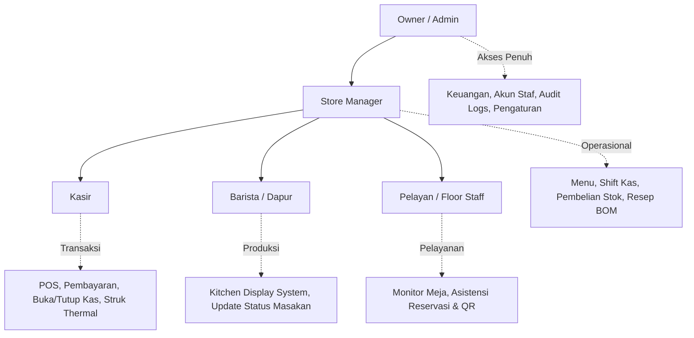

# PANDUAN OPERASIONAL KAFE KOPIRISE (SOP)

Panduan standar operasional prosedur bagi seluruh peran karyawan di **KopiRise Cafe & Resto Jember**.

---

## 1. Peran & Hak Akses (RBAC)

---

## 2. Alur Kasir (Point of Sale & Shift Kas)

### 2.1 Membuka Shift Kasir (Awal Hari / Pergantian Shift)
1. Buka browser tablet kasir pada URL `/admin/pos`.
2. Jika shift belum aktif, klik **"Buka Shift Kasir Baru"**.
3. Hitung uang modal kembalian di laci fisik (default standar: **Rp 500.000**).
4. Masukkan nominal uang modal awal dan klik **"Konfirmasi Buka Shift"**.
5. Sistem menerbitkan nomor shift unik (misal: `SHF-20261026-01`).

### 2.2 Memproses Pesanan Langsung di Kasir
1. Pilih mode pesanan: **Dine-In** (pilih nomor meja) atau **Takeaway** (bungkus).
2. Input nama pelanggan untuk memudahkan panggilan saat sajian siap.
3. Klik item menu yang dipesan. Jika menu memiliki pilihan (suhu panas/dingin, level gula, topping), atur pada modal pop-up.
4. Klik **"Proses Pembayaran"**.
5. Pilih metode pembayaran:
   - **Tunai**: Masukkan nominal uang yang diserahkan pelanggan. Sistem menghitung uang kembalian secara otomatis. Serahkan struk dan uang kembalian.
   - **QRIS**: Minta pelanggan memindai kode QRIS pada display kasir. Setelah pelanggan menunjukkan notifikasi berhasil, klik **"Konfirmasi Pembayaran Selesai"**.
   - **Bank Transfer**: Periksa mutasi rekening BCA bisnis.
6. Klik **"Cetak Struk Thermal"** untuk mencetak struk 58mm/80mm ke printer kasir.

### 2.3 Menutup Shift Kasir (Akhir Shift)
1. Pada bar status shift kasir, klik **"Tutup Shift Kasir & Rekonsiliasi"**.
2. Keluarkan seluruh uang fisik dari laci kasir dan hitung nominal totalnya.
3. Masukkan jumlah uang fisik aktual pada kolom **"Hitung Uang Fisik Aktual"**.
4. Sistem membandingkan uang fisik vs kas seharusnya:
   $$\text{kas\_seharusnya} = \text{kas\_awal} + \text{penjualan\_tunai} + \text{kas\_masuk} - \text{kas\_keluar}$$
5. Jika ada selisih (*shortage* atau *overage*), tuliskan penjelasan pada kolom catatan rekonsiliasi.
6. Klik **"Selesaikan & Tutup Shift"**.

---

## 3. Alur Dapur & Barista (Kitchen Display System - KDS)

1. Buka layar display dapur pada URL `/admin/kds`.
2. Setiap kali ada pesanan masuk dari kasir atau QR meja pelanggan, tiket baru otomatis muncul di layar.
3. **Mulai Diracik**: Klik tombol `Mulai Diracik` saat barista mulai menyeduh kopi atau koki mulai memasak makanan. Status tiket berubah menjadi warna kuning (*preparing*).
4. **Siap Disajikan**: Klik tombol `Tandai Siap Saji` setelah makanan/minuman selesai ditata di piring/cup. Tiket berubah menjadi warna hijau (*ready*). Pelayan akan segera membawa hidangan ke meja.
5. **Selesai**: Setelah pelayan mengantarkan hidangan ke meja tamu, klik `Sudah Diantar ke Tamu ✓`. Tiket otomatis diarsipkan dari layar.

---

## 4. Alur Pemesanan Mandiri Meja (QR Code Pelanggan)

1. Pelanggan duduk di salah satu dari 24 meja yang tersedia.
2. Pelanggan memindai stiker QR pada meja menggunakan kamera smartphone.
3. Halaman khusus meja tersebut langsung terbuka tanpa perlu instalasi aplikasi atau registrasi akun.
4. Pelanggan memilih sajian, menyesuaikan opsi (suhu, topping, catatan), dan menekan **"Kirim Pesanan"**.
5. Pesanan langsung masuk ke antrean KDS Barista dan POS Kasir secara bersamaan. Meja otomatis berubah status menjadi *occupied*.

---

## 5. Alur Reservasi Meja (Manajemen & Tamu)

1. Pelanggan mengisi formulir reservasi di `/reservasi`.
2. Sistem mengecek ketersediaan meja dan memastikan tidak terjadi bentrok jadwal (*double booking*):
   $$\text{Overlapping} \iff (\text{jam\_mulai\_baru} < \text{jam\_selesai\_lama}) \land (\text{jam\_selesai\_baru} > \text{jam\_mulai\_lama})$$
3. Pelanggan mendapatkan kode unik (contoh: `RSV-20261026-0001`).
4. Manager memeriksa daftar reservasi harian pada dashboard admin dan menyetujui status menjadi *confirmed*.
5. Tamu dapat mengecek status reservasinya kapan saja di `/reservasi/status`.

---

## 6. Penanganan Kendala Teknis (Troubleshooting)

- **Kertas Struk Kasir Habis**: Buka penutup printer thermal 58mm/80mm, masukkan gulungan kertas thermal baru dengan posisi kertas menghadap ke atas, tutup penutup hingga berbunyi klik. Cetak ulang struk dari riwayat order POS.
- **Koneksi Internet Terputus**: SQLite dan backend lokal tetap melayani pencatatan transaksi POS secara offline. Data tersinkronisasi kembali saat jaringan pulih.
- **Lupa Password Karyawan**: Admin/Owner dapat melakukan reset password instan melalui menu manajemen pengguna di `/api/v1/users/{id}/reset-password`.
